## Задача 1. Число обусловленности вручную.

Для каждой функции вычислите число обусловленности cond = |x · f'(x) / f(x)| в указанной точке и
определите, хорошо или плохо обусловлена задача:
1. f(x) = √x при x = $10^{-8}$
2. f(x) = ln x при x = 1.001
3. f(x) = x − 1 при x = 1.000001
4. f(x) = sin x при x = π/2

Вывод: расположите задачи по возрастанию обусловленности. Какая из них самая «опасная» и
почему

## Вывод:

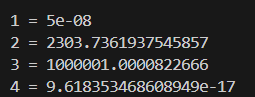

Подрядок задачи по возрастанию обусловленности: 4 - 1 - 2 - 3

Самая опасная 3, так как ее cond сильно больше единицы. Значит что даже самые малые изменения на входе вызовут значительные изменения на выходе.

## Задача 2. Вычитание близких чисел как плохая обусловленность.

Дана задача f(a, b) = a − b. Покажите аналитически, что при a ≈ b число обусловленности по a и по
b велико. Затем проверьте численно: возьмите a = 1 +  $10^{-8}$, b = 1 и посчитайте Δf / δa при δa =
$10^{-9}$. Совпадает ли фактическое изменение результата с предсказанием по cond? Объясните в 2–3
предложениях.

## Вывод:

Аналитически - если брать частную производную по a то формула будет cond = [a / (a - b)] (в этом случае производная будет 1). Для b действует тот же принцип. Поскольку a ≈ b, то a − b стремится к 0, а значит cond будет стремится к бесконечности. 

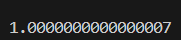

Δf / δa при δa = $10^{-9}$ не совпадает с cond, так как в этой ситуации Δf = $10^{-9}$, и при делении получается 1 (и будет получатся при любом другом δa).

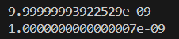

Δf сама по себе выдала подходящее число, чтобы при уножении на cond составить правильную пропорцию к результату без добавлений δa.

## Задача 3. Кратные корни — плохая обусловленность.

Рассмотрите уравнение $x^{2}$ − 2x + 1 = 0 (корень x = 1 кратности 2). Измените свободный член на 1
− ε для ε = $10^{-2}$, $10^{-4}$, $10^{-6}$. Найдите корни через math.sqrt и посмотрите, насколько сдвинулся корень относительно x = 1. Постройте таблицу: ε → сдвиг корня → отношение сдвигов. Сделайте
вывод о связи кратности корня и обусловленности.

## Вывод:

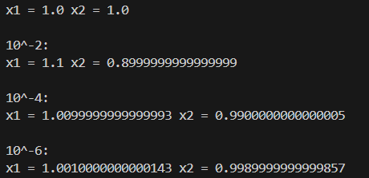

| ε | сдвиг корня | отношение сдвигов |
|---|---|---|
| $10^{-2}$ | x1 = 1.1 / x2 = 0.9 | 0.1 | 
| $10^{-4}$ | x1 = 1.01 / x2 = 0.99 | 0.01 | 
| $10^{-6}$ | x1 = 1.001 / x2 = 0.999 | 0.001 |

## Задача 4. Обусловленность vs устойчивость — различие.
Приведите свой пример (не из лекции) задачи, которая хорошо обусловлена, но для которой
можно написать неустойчивый алгоритм. Реализуйте оба: устойчивый и неустойчивый
варианты, покажите расхождение на диапазоне входных данных. В выводе чётко разделите: «в
чём проблема задачи» и «в чём проблема алгоритма».

## Вывод:

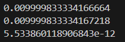

Хорошо обусловленная задача f = sin(x). Значение x пропорционально значению f(x). Неустойчивый алгоритм: f = √(1 - $cos^{2}$(x)). По правилам тригонометрии функции тождественно равны, однако, когда приходится вычитать близкие к 0 величины, в неустойчивом алгоритме появляется cos(0) = 1. В итоге результат стремится к 0, что дает расхождения.

| х | устойчивый алгоритм | не устойчивый алгоритм | разница |
|---|---|---|---|
| $10^{-1}$ | 0.09983341664682815 | 0.09983341664682761 | 5.412337245047638e-13 % |
| $10^{-2}$ | 0.009999833334166664 | 0.009999833334167218 | -5.533767888366015e-12 % |
| $10^{-4}$ | 9.999999983333334e-05 | 9.999999969612645e-05 | 1.3720689623526738e-7 % |
| $10^{-6}$ | 9.999999999998333e-07 | 1.0000444493033002e-06 | 0.004444930346690951 % |
| $10^{-8}$ | 1e-08 | 0.0 | 100 % |

## Задача 5. Квадратное уравнение — классика.
Для a = 1, b = $10^{8}$, c = 1 вычислите меньший корень двумя способами:
- «плохо»: x₂ = (−b + √(b² − 4ac)) / 2a
- «хорошо»: x₂ = 2c / (−b − √(b² − 4ac))
Сравните с эталоном через mpmath (или decimal с 50 знаками). Посчитайте относительную
погрешность обоих способов. Повторите для b = $10^{4}$ и b = $10^{12}$. Постройте таблицу: b → ошибка
плохого → ошибка хорошего. Сделайте вывод: при каком b «плохой» способ начинает
катастрофически ошибаться?

## Вывод:

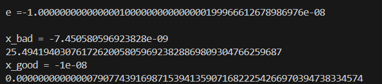

| b | ошибка плохого | ошибка хорошего |
|---|---|---|
| $10^{4}$ | 0.0000001 % | 0.000000000000006 % |
| $10^{8}$ | 25.5 % | 0.000000000000008 % |
| $10^{12}$ | 100 % | 0.000000000000002 % |

Начиная с b = $6^{7}$ ошибка составляет более 10 %, далее «плохой» способ начинает
катастрофически ошибаться

## Задача 6. (1 − cos x) при малых x.

Реализуйте два способа вычисления f(x) = (1 − cos x) / x²:
- «плохо»: прямо в лоб;
- «хорошо»: через тождество 2·sin²(x/2) / x².
Прогоните x = $10^{-2}$, $10^{-4}$, $10^{-6}$, $10^{-8}$, $10^{-10}$. Эталон — через mpmath . Постройте таблицу относительной ошибки обоих способов от x в log-log масштабе. Определите, при каком x ошибка «плохого» способа превышает 1%. Сформулируйте правило, когда нужно искать
тригонометрическое тождество.

## Вывод:

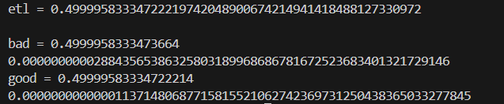

| x | ошибка плохого | ошибка хорошего |
|---|---|---|
| $10^{-2}$ | 0.00000000003 % | 0.00000000000001 % |
| $10^{-4}$ | 0.0000005 % | 0.00000000000002 % |
| $10^{-6}$ | 0.009 % | 0.000000000000004 % |
| $10^{-8}$ | 100 % | 8.3 % |
| $10^{-10}$ | 100 % | 8.3 % |

Начиная с x = $6^{-8}$ ошибка составляет более 1 %. Тригонометрическое тождество следует искать тогда, когда приходится вычитать близкие величины (cos(0) = 1). В нашем примере как раз такой случай. Х стримится к 0, cos стремится к 1.

## Задача 7. √(x+1) − √x при больших x.

Реализуйте два способа:
- «плохо»: √(x+1) − √x;
- «хорошо»: 1 / (√(x+1) + √x).
Прогоните x = $10^{4}$, $10^{8}$, $10^{12}$, $10^{14}$, $10^{16}$. Эталон — mpmath с 50 знаками. Постройте таблицу относительной ошибки. Определите, как ошибка «плохого» способа растёт с x (оцените
показатель степени). Сделайте вывод.

## Вывод:

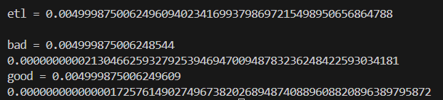

| x | ошибка хорошего | ошибка плохого |
|---|---|---|
| $10^{4}$ |  0.00000000002 % | 0.000000000000002 % |
| $10^{8}$ | 0.000000000000009 % | 0.000001 % |
| $10^{12}$ | 0.00000000000001 % | 0.0008 % |
| $10^{14}$ | 0.000000000000006 % | 0.6 % |
| $10^{16}$ | 0.000000000000005 % | 100 % |

Ошибка плохого способа растет вместе с х, так как в плохом способе мы мы вычитаем √(x+1) − √x. Чем больше число, тем меньше значения оказывает "+1", следовательно число стремится к 0.
 
## Задача 8. Экспонента и логарифм.

Для f(x) = ln(1 + x) при малых x реализуйте:
- «плохо»: math.log(1 + x);
- «хорошо»: math.log1p(x).
Прогоните x = $10^{-2}$, $10^{-8}$, $10^{-12}$, $10^{-14}$. Эталон — mpmath.log(1 + x) . Посчитайте
относительную ошибку обоих способов. Объясните, что делает log1p внутри (загляните в
документацию Python) и почему он устойчив. Сделайте вывод о том, зачем в стандартной
библиотеке есть «странные» функции типа log1p, expm1, hypot.

## Вывод:

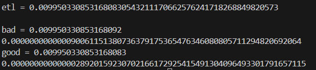

| x | ошибка хорошего | ошибка плохого |
|---|---|---|
| $10^{-2}$ |  0.000000000000003 % | 0.00000000000009 % |
| $10^{-8}$ | 0.000000000000005 % | 0.0000006 % |
| $10^{-12}$ | 0.000000000000002 % | 0.009 % |
| $10^{-14}$ | 0.000000000000005 % | 0.08 % |

Функция log1p реализована через ряд Тейлора, блягодаря этому можно не боятся, что маленькое значение x не будет давать результата при сложении с 1. Такой метод позволяет сохранить точность. Функция expm1(x) позволяет сохранить точность при вычитании малых чисел, а функция math.hypot позволяет отсрочить переполнение при возведении в степень.

## Задача 9. Неустойчивость накопления в сумме.

Вычислите Sₙ = Σ (k = 1..n) 1/k для n = $10^{5}$, $10^{6}$, $10^{7}$ тремя способами:
1. наивный цикл слева направо;
2. sum(arr);
3. math.fsum(arr).

Эталон — mpmath с 50 знаками. Для каждого n посчитайте относительную ошибку всех трёх
способов. Постройте таблицу ошибки от n в log-log. Оцените, как растёт ошибка наивного
способа с n. Сделайте вывод: при каком n наивная сумма становится неприемлемой (ошибка >
$10^{-10}$)?

## Вывод:

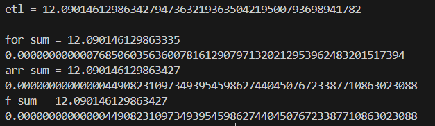

| x | ошибка цикла | ошибка суммы | ошибка f_суммы |
|---|---|---|---|
| $10^{5}$ |  0.0000000000008 % | 0.000000000000004 % | 0.000000000000004 % |
| $10^{6}$ | 0.000000000005 % | 0.000000000000005 % | 0.000000000000005 % |
| $10^{7}$ | 0.00000000002 % | 0.000000000000004 % | 0.000000000000004 % |

По тенденции роста ошибки в цикле, сумма станет неприемлемой (ошибка > $10^{-10}$) при $10^{8}$, проверить это не удалось из-за нехватки памяти.

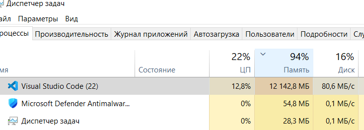

## Задача 10. Разделение источников ошибки.

Возьмите задачу из задачи 6. Проведите три эксперимента:
- (а) меняем x, фиксируем алгоритм (плохой) — видим рост ошибки из-за обусловленности/
сокращения;
- (б) фиксируем x, меняем тип float (float32 через numpy.float32 vs float64) — видим рост
ошибки из-за машинной точности;
- (в) меняем алгоритм (плохой vs хороший), фиксируем x — видим эффект устойчивости.

Оформите таблицу: какой фактор на сколько порядков меняет ошибку. Сформулируйте вывод:
какой источник в каждом случае доминирует.

## Вывод:

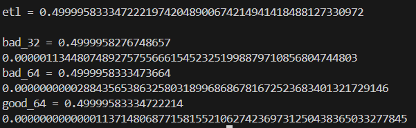

| x | ошибка плохого | ошибка плохого f_64 | ошибка хорошего f_64 |
|---|---|---|---|
| $10^{-2}$ | 0.000001 % | 0.00000000003 % | 0.00000000000001 % |
| $10^{-4}$ | 0.00000008 % | 0.0000005 % | 0.00000000000001 % |
| $10^{-6}$ | 0.008893 % | 0.008890 % | 0.000000000000004 % |
| $10^{-8}$ | 100 % | 100 % | 8.3 % |
| $10^{-10}$ | 100 % | 100 % | 8.3 % |

При значении $10^{-2}$ ошибка доминирует в 32 бита, так как разнядность не позволяет фиксировать такую точность. При значениях менее $10^{-6}$ критическая ошибка возникает в обоих плохих методах, так как точноти не хвадает даже при 63 битах.

## Задача 11. Эталон — обязателен.

Придумайте (или возьмите из задач 5–9) пример, в котором два float-результата совпадают
между собой, но оба неверны относительно точного эталона. Реализуйте: два алгоритма,
сравнение друг с другом через ==, сравнение каждого с mpmath. Сделайте вывод о том, почему
сравнивать float с float без эталона — ошибка.

## Вывод:

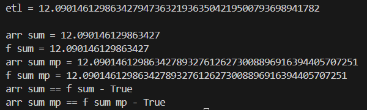

| x | эталонный результат | результат суммы | результат f_суммы | результат суммы с mpmath | результат f_суммы с mpmath | проверка через == | проверка с использованием mpmath |
|---|---|---|---|---|---|---|---|
| $10^{5}$ | 12.09014612 9863427947 3632193635 0421950079 3698941782 | 2.090146129863427 | 2.090146129863427 | 12.09014612 9863427893 2761262730 0889691639 4405707251 | 12.09014612 9863427893 2761262730 0889691639 4405707251 | True | True |

При увеличении точности float точность ответа также растет, ошибка будет уменьшатся, но в зависимости от алгорритма увеличенной точности так же может не зватить, даже если на повишенной точности результаты разных алгоритмов будут сходиться, это не дает гарантии, что результат верный, поэтому сравнение с эталоном обязательно.

## Задача 13. Воспроизводимость эксперимента.
Напишите эксперимент, который генерирует $10^{5}$ случайных чисел через random.seed(42) и
numpy.random.default_rng(42). Суммируйте их тремя способами (sum, math.fsum, numpy.sum). Запустите дважды с одним seed — результаты должны совпасть. Запустите с seed=43 — покажите, что расхождения между способами не «случайны», а систематичны. Оформите отчёт с указанием: версия Python, версия numpy, seed. Сделайте вывод о том, почему без фиксации seed и версий эксперимент не воспроизводим.

## Вывод:

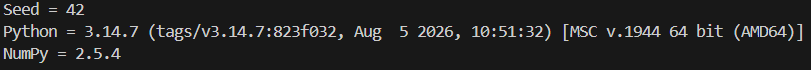

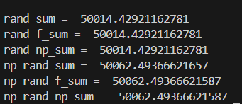

| N | random sum | random math.fsum | random numpy.sum | numpy.random sum | numpy.random math.fsum | numpy.random numpy.sum | 
|---|---|---|---|---|---|---|
| 42 | 50014.42921162781 | 50014.42921162781 | 50014.42921162781 | 50062.49366621657 | 50062.49366621587 | 50062.49366621587 |
| 43 | 50095.68089589526 | 50095.68089589526 | 50095.68089589526 | 49999.542597390566 | 49999.542597390275 | 49999.542597390275 |

Повторная генерация дает одинаковые результаты. Фиксация сида обязательная, так как без нее, сгенерированные значения будут иными, так же обязательно отслеживать версии библиотек, потому что в разных версиях могут отличатся алгоритмы генерации.
