## Задача 1. Ручной счёт.
Даны приближённые и точные значения. Для каждой пары вычислите абсолютную погрешность
Δx и относительную δx (в %):
1. x = 3.14, x* = π
2. x = 2.718, x* = e
3. x = 9.8, x* = 9.81 (ускорение свободного падения)
4. x = 0.333, x* = 1/3

Вывод: расположите пары по «качеству» приближения. Совпадает ли порядок по Δx и по δx?
Если нет — объясните почему.

## Вывод:

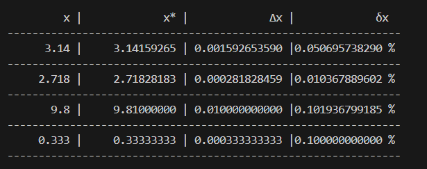

Пары по "качеству" приближения по абсолютной погрешности:
- 2 - 4 - 1 - 3
 
Пары по "качеству" приближения по приблеженной погрешности:
- 2 - 1 - 4 - 3
 
Разница в последовательности возникает из-за того, что абсолютная погрешность показывает прямую
разницу между числами не беря в расчет их пропорцию. Относительная погрешность показывает ошибку
в процентах, что позволяет увидить "цену" ошибки, относительно самих чисел.

## Задача 2. Сравнение несопоставимых величин.

Инженер измерил:
- длину моста: x = 1247 м при точном 1250 м;
- диаметр болта: x = 9.7 мм при точном 10.0 мм.

Вычислите Δx и δx для обоих. Кто ошибся «сильнее»? Почему ответ зависит от того, какую
погрешность мы выбрали? Сформулируйте вывод в 2–3 предложениях.

## Вывод:

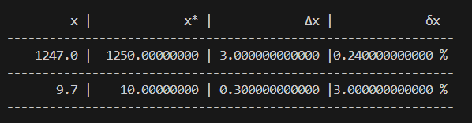

Ошибся сильнее инжинер с болтами. Абсолютная погрешность показывает большую ошибку у мостовика,
однако, такое сравнение не корректно, так как у нас изнчально разные масштабы (км / мм), 
относительная погрешность показывает ошибку с поправкой на масштаб, мостовик ошибся 
на 0.24 %, а инжинер с болтом на целых 3 %

## Задача 3. Функция relative_error 

Напишите функцию:
```
def relative_error(approx, exact):
return abs(approx - exact) / abs(exact)
```
Добавьте защиту: если exact == 0, вернуть float('inf') и не падать с ZeroDivisionError . Проверьте на четырёх парах из задачи 1.

## Вывод:

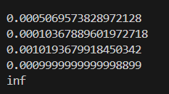

Функция работает, 'inf' тоже выводит в функции таблицы заменил расчет отоносительной погрешности на вызов функции.

## Задача 4. Обратная задача — оценка точного значения.

Известно, что приближение x = 47.3 имеет относительную погрешность не более 0.1%. В каком
диапазоне лежит x*? Запишите ответ в виде интервала [a, b] с разумным числом значащих цифр.

## Вывод:

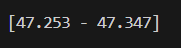

Чтобы выяснить диапазон x*, необходимо учесть процент погрешности в приближенном значении:

х* = x / 1 +- 0.001 

Диапазон х* = [47.253 - 47.347]

## Задача 5. Порог по абсолютной и относительной ошибке.

Есть два датчика температуры. Датчик A врёт с абсолютной ошибкой не более 0.3 °C, датчик B —
с относительной ошибкой не более 0.5%. При какой температуре датчик B точнее (в смысле Δ ≤
0.3)? Решите неравенство |T| · 0.005 ≤ 0.3 и объясните, почему выбор датчика зависит от
диапазона измерений.

## Вывод

Датчик B будет меньше врать тогда, когда 0.5% будут меньше чем 0.3 градуса:

|T| * 0.005 <= 0.3

|T| = 0.3 / 0.005 = 60.0

Диапазон, при котором датчик B точнее [-60.0; 60.0]

## Задача 6. Подсчёт значащих цифр.

Для каждого числа определите количество значащих цифр и запишите в экспоненциальной форме
так, чтобы количество значащих цифр было однозначным:
1. 0.004520
2. 1200
3. 1.200
4. 10.03
5. 0.03050
6. 250000
Вывод: в каких случаях запись без экспоненциальной формы неоднозначна и почему?

## Вывод:
| № | число | количество значющих цифр | в экспоненциальной форме |
|---|---|---|---|
| 1 | 0.004520 | 4 |  $4.520 \times 10^{-3}$ |
| 2 | 1200 | 2 / 4| $1.2 \times 10^{3}$ / $1.200 \times 10^{3}$|
| 3 | 1.200 | 4 | $1.200 \times 10^{0}$ |
| 4 | 10.03 | 4 | $1.030 \times 10^{1}$ |
| 5 | 0.03050 | 4 | $3.050 \times 10^{-2}$ |
| 6 | 250000 | 2 / 6 | $2.5 \times 10^{5}$ / $2.50000 \times 10^{5}$ |

Запись без экспоненциальной формы неоднозначна в случаях для 1200 и для 250000. Для целых чисел, оканчивающихся нулями, без запятой, невозможно отличить значащие конечные нули от нулей, указывающих только величину. 

## Задача 7. Честная запись результата.

Измерение дало x = 4.738291 с абсолютной погрешностью Δ = 0.02. Запишите результат в виде x
± Δ, оставив только верные значащие цифры (правило: последняя оставляемая цифра должна
быть в том же разряде, что и погрешность). Сколько значащих цифр осталось? Что было бы
неверно в записи 4.738291 ± 0.02?

## Вывод:

x ± Δ = [4.72 - 4.76] - 3 начащие цифры в изначальной записи нарушено правило послежней оставляемой цифры, которая обязана совпадать с разрядам с числом точности

## Задача 8. Округление и banker's rounding.

Проверьте в Python:
```
print(round(0.5), round(1.5), round(2.5), round(3.5),
round(-0.5), round(-1.5), round(-2.5))
```
Объясните, почему результат отличается от «школьного» правила «0.5 всегда вверх». Посчитайте,
какой систематический сдвиг накопится на массиве из $10^{6}$ чисел, каждое из которых — случайное
k + 0.5 для k = 0..9, если округлять «вверх» вместо banker's rounding. Сделайте вывод, почему в
финансах это критично.

## Вывод:

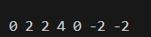

По правилам округления половина округляет число в сторону четного числа (0 это четное), поэтому вывод отличается от ожидаемого школой. 

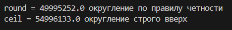

Для массива из $10^{6}$ случайных чисел при округлении по правили у стого вверх сдвиг вышел 5 миллионов. Для финансов это кртично, так как показывает завышенный результат по сравнению с округлением по правилу.

## Задача 9. Промежуточное округление — зло.

Вычислите двумя способами S = Σ (k = 1..100) 1/k:
(а) без промежуточных округлений (float);
(б) с округлением каждого слагаемого до 3 знаков после запятой.
Сравните с эталоном 
math.fsum и посчитайте ΔS и δS для обоих вариантов. Во сколько раз
ошибка варианта (б) больше? Сформулируйте правило.

## Вывод

- a = 5.187377517639621 
- б = 5.1859999999999955 
- fsum = 5.187377517639621 

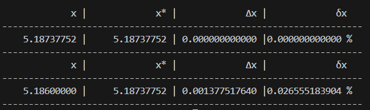

ΔS а = 0
ΔS б = 0.0014

δS а = 0
δS б = 0.0266 %

В моем случае ошибка без промежуточных округлений относительно эталона составляет 0! 
По математике ошибка с округлением в бесконечность раз больше.

## Задача 10. Классика 0.1 + 0.2.

Выведите 
0.1 + 0.2, сравните с 
0.3 через 
== и через 
math.isclose . Найдите Δ и δ этого
расхождения. Объясните в 3 предложениях (без формул, «на пальцах»), почему 0.1 не
представимо точно в двоичной системе.

## Вывод:

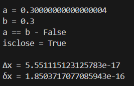

0.1 не представимо точно в двоичной системе из-за особенностей правил, по которым числа переводятся в двоичную систему. Из-за этих правил некоторые числа входят в бесконечность и не могут быть переведены в привычной флрме.

## Задача 11. Катастрофическая потеря точности.

Вычислите a − b для a = 1 + $10^{-15}$, b = 1. Ожидаемый ответ — $10^{-15}$. Сравните с фактическим
результатом в Python. Посчитайте относительную погрешность результата. Затем перепишите
квадратичную формулу для корней ax2 + bx + c = 0 при a = 1, b = $10^{8}$, c = 1 так, чтобы избежать
вычитания близких чисел, и покажите, насколько точнее получается меньший корень.

## Вывод:

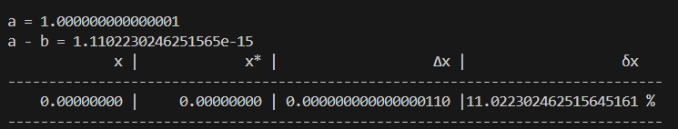

Меньший по модулю корень имеет формулу (-b + √D) / 2a. Из-за большого масштаба b эта формула вычитает близкие числа, что вызывает ошибку. После домнажения на сопряженное выражение формула меньшего крня имеет вид -2c / (b + d). Новая формула повышает точность на 25.494 %.

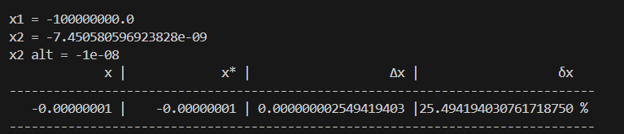

## Задача 12. Накопление в цикле — сравнение стратегий.
Сложите массив из $10^{6}$ элементов 
[0.1] * 1_000_000 тремя способами:
```
1. наивный цикл 
for x in arr: total += x;
2. sum(arr) ;
3. math.fsum(arr) .
```
Сравните с эталоном 1e5. Для каждого способа посчитайте абсолютную и относительную
погрешность. Постройте таблицу и сделайте вывод: какой способ и во сколько раз точнее.

## Вывод:

Согласно ожиданиям самым точным методом должет был стать math.fsum, однако, расчеты показали, что в данным случае math.fsum(arr) и sum(arr) не имею погрешности, вообще.

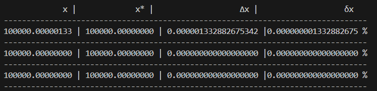

Чтобы проверить наверняка, числа были выведены с большей точностью:

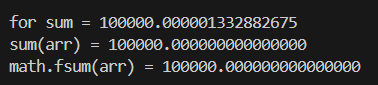
