## Задача 1. Инвентаризация массива.

Создайте массив np.arange(60).reshape(3, 4, 5). Выведите shape, ndim, size, dtype, strides, C_CONTIGUOUS. Объясните в 2–3 предложениях, что означает каждое число в strides и почему size = 60.

## Вывод:

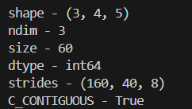

strides показывает на сколько байт нужно сдвинуться чтобы перейти к следующему измерению в матрице, в обратном порядке. 8 байт до следубщего элемента, 40 до стледующей строки, 160 до следующего блока в третьем пространтве. size = 60 потому что нужно перемножить все значениия для нахождения размера.

## Задача 2. int vs float — тихая ловушка.

Создайте a = np.array([1, 2, 3, 4]). Выполните a / 2, a // 2, a / 2.0, a.dtype, (a / 2).dtype, (a // 2).dtype. Затем создайте b = np.array([1, 2, 3], dtype=np.int8), прибавьте 127 и выведите результат и dtype. Объясните: почему a / 2 не меняет a, а b + 127 даёт странный результат, и почему NumPy не падает с ошибкой.

## Вывод:

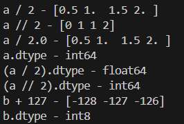

a / 2 не меняет a так как, при выводе создается новый массив для результата. а b + 127 так как np.int8 заниамет 8 бит, самый старший бит отвечает за знак, а 127 это максимальное число. если а не 0, тогда + 127 вызывает переполнение и перенос числового разряда в знаковый. NumPy не падает, так как эта библиотека не отслеживает факт переполнения.

## Задача 3. float32 vs float64 — реальная точность.

Сравните np.float32(0.1) - np.float32(0.1) не поможет; сделайте иначе: float(np.float32(0.1)) - 0.1 и float(np.float64(0.1)) - 0.1. Выведите оба числа в repr и в :.20e. Посчитайте, во сколько раз ошибка float32 больше ошибки float64. Сделайте вывод: в каких задачах численных методов float32 допустим, а в каких — нет.

## Вывод:

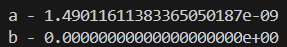

Ошибка float32 больше ошибки float64 больше ровно на 1.49011611383365050187e-09. Поскольку в Python 0.1 это и так float64, то мы получаем 0 при float(np.float64(0.1)) - 0.1. float32 допустим в задачат точностью до $10^{-7}$ так как эти придел его вместимости, так же необходимо, чтобы остальные числа так же соответствовали float32.

## Задача 4. Явный dtype при создании.

Создайте четыре массива одинакового размера (2, 3):
- np.zeros с dtype=np.float64;
- np.zeros с dtype=np.float32;
- np.ones с dtype=np.int16;
- np.full со значением 7 и dtype=np.uint8.

Выведите dtype и nbytes каждого. Посчитайте, сколько байт экономит float32 по сравнению с float64 на массиве (1000, 1000). Сделайте вывод о компромиссе «память vs точность».

## Вывод:

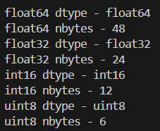

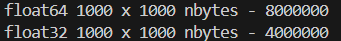

float32 по сравнению с float64  занимает в 2 раза меньше, так как 32 в 2 раза меньше чем 64. Если в нашей задаче не требуется высокая точность, то можно использовать меньшие типы для экономии памяти, но современные пк имеют достаточно памяти, чтобы намеренно не использовать уменьшенные типы ради экономиии памяти в большенстве задач.

## Задача 5. Цепочка reshape.

Создайте a = np.arange(24). Преобразуйте последовательно в (4, 6), (2, 3, 4), (2, 2, 6), (24,). После каждого шага выведите shape и проверьте через np.array_equal(a, текущий.ravel()), что данные не потерялись. Объясните: почему reshape обычно не копирует данные и когда он вынужден скопировать.

## Вывод:

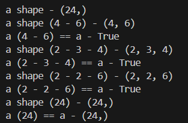

reshape обычно не копирует данные, так как он не меняет сами данные, а меняет форму. Уопирование данных может понадобится в случае, окгда текущий объем данных ен возможно прриобразовать в нужную форму.

## Задача 6. flatten vs ravel — копия или view.

Создайте M = np.arange(12).reshape(3, 4). Получите f = M.flatten() и r = M.ravel(). Выведите f.base is None, r.base is M (или r.base is not None). Измените f[0] = 999 и r[1] = 888 — проверьте, изменился ли M в каждом случае. Сделайте вывод: когда использовать ravel, когда flatten.

## Вывод:

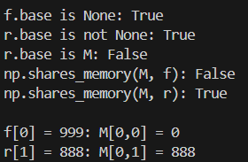

flatten создает копию и не трогает оригинальные данные, ravel ссылка на место в памяти. flatten стоит использовать, когда нам нужно будет зафиксировать исходные данные, в других случаях можно использовать ravel.

## Задача 7. newaxis, squeeze, транспонирование.

Создайте v = np.arange(5). Получите:

1) v[:, None] — форма?
2) v[None, :] — форма?
3) np.squeeze(v[:, None]) — форма?
4) np.arange(6).reshape(2, 3).T — форма и содержимое.

## Вывод:

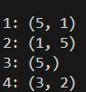

## Задача 8. Транспонирование без копии.

Создайте A = np.arange(6).reshape(2, 3). Получите B = A.T. Проверьте B.base is A (или B.base is not None). Измените B[0, 1] = 999 — изменился ли A? Сделайте вывод: почему .T — view, а не копия, и как это связано с strides.

## Вывод:

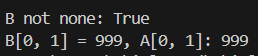

.T не является копией, так как не меняет сами данніе, а меняет только форму. strides в этом случае говорит, что данные те же самые, но при перечислении нужно менять шаг, так как форма была изменена.

## Задача 9. Поэлементно vs матричное.

Создайте A = np.arange(6).reshape(2, 3) и B = np.arange(6).reshape(3, 2). Выполните A @ B, A.T @ B.T, A * A. Выведите формы и значения. Объясните: почему A * B даёт ошибку (или работает?) и в чём разница между * и @. Приведите пример, когда * и @ дают одинаковый результат (подсказка: диагональная матрица).

## Вывод:

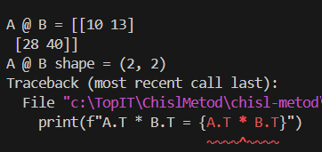

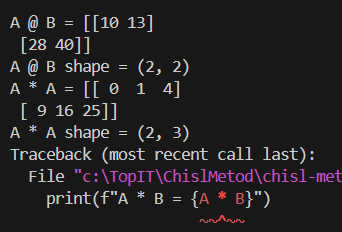

@ это умножение матриц по правилам линейной алгибры. * это умножение поэлементное, поэтому при несовпадении размеров, падает ошибка. * и @ могут дать одинаковый результат если используется диагональная матрица (мтрица со всем нулями, кроме главной диагонали)

## Задача 10. axis=0 vs axis=1.

Создайте M = np.arange(12).reshape(3, 4). Вычислите M.sum(axis=0), M.sum(axis=1), M.mean(axis=0), M.mean(axis=1), M.argmax(axis=0), M.argmax(axis=1). Для каждой операции объясните одной строкой: по какой оси «свернули» и что означает результат. Проверьте на маленьком примере, что M.sum(axis=0) — это сумма по столбцам, а не по строкам.

## Вывод:

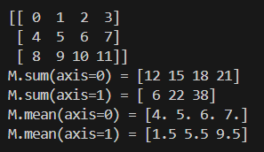

- sum(axis=0) - сумма по столбцам
- sum(axis=1) - сумма по строкам
- mean(axis=0) - среднее по столбцам
- mean(axis=0) - индекс строки, в которой максимальное значение каждого столбца
- argmax(axis=1) - индекс столбца, в которой максимальное значение каждой строки.

## Задача 11. keepdims и broadcasting.

Создайте X = np.random.default_rng(42).normal(size=(5, 3)). Вычислите X.mean(axis=0) (форма (3,)) и X.mean(axis=0, keepdims=True) (форма (1, 3)). Выполните X - X.mean(axis=0) и X - X.mean(axis=0, keepdims=True) — обе формы должны дать (5, 3). Затем посчитайте X.std(axis=1) без keepdims и с ним, и нормируйте строки: (X - X.mean(axis=1, keepdims=True)) / X.std(axis=1, keepdims=True). Убедитесь, что средние по строкам ≈ 0, std по строкам ≈ 1. Объясните, зачем нужен keepdims.

## Вывод:

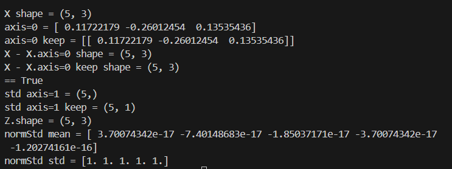

keepdims позволяет не удалить строки после расчетов данных, а заполнить их единицами, что позволяет сохранить изначальный размер.

## Задача 12. Срез — view, не копия.

Создайте a = np.arange(10). Получите b = a[2:5]. Измените b[0] = 999 и проверьте a. Затем повторите с c = a[2:5].copy() — изменился ли a? Объясните: почему это важно для численных методов (подсказка: если вы «обрезаете» данные для анализа и случайно меняете оригинал, что произойдёт с экспериментом?). Приведите пример, когда view — преимущество (экономия памяти), а когда — баг.

## Вывод:

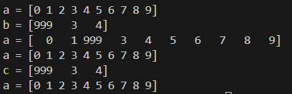

При использовании copy() создается копия изначального объекта, если мы проводим анализ, то это важно для сравнения новых данных с исходными, однако, если мы работаем со слишком большими значениями, то это может вызывать недостаток памяти, в таком случае лучше не создавать копии а работать с исходным объектом view.