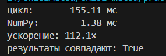
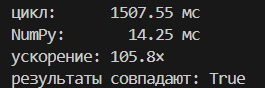
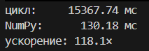
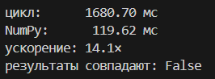
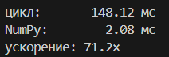
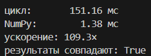
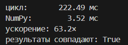
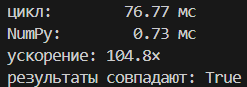

## Задача 1. Сумма массива.

Сравните:
- цикл `for x in a: s += x`;
- `a.sum()`.

Запустите `compare` на `n = 10^5, 10^6, 10^7`. Постройте таблицу «n → ускорение». Оцените, как ускорение зависит от `n` и почему. В выводе ответьте: при каком `n` разница становится заметной (>10×)?

## Вывод:

Чем больше n тем больше накапливается задаржка. Разница становится заметной уже при n > 20, но от запуска к запуску значение может меняться

## Задача 2. Среднее и стандартное отклонение.

Реализуйте среднее и std:
- «в лоб»: цикл с суммой и суммой квадратов, потом формула;
- NumPy: `a.mean()`, `a.std()`.

Сравните на `n = 10^6`. Проверьте, совпадают ли результаты до `1e-12`. 

## Вывод:

Цикл и NumPy совпали при поиске среднего, но не свопали при поиске квадратичного.

## Задача 3. Поэлементное преобразование.

\(y = \sin(x) + x^2\).**
Реализуйте:
- цикл с `math.sin(x) + x*x`;
- NumPy: `np.sin(a) + a**2`.

Сравните на `n = 10^6`. 

## Вывод:

## Задача 4. Условная замена (clipping).

Замените все значения `< 0` на 0, все `> 1` на 1:
- «в лоб»: цикл с `if/elif`;
- NumPy: `np.clip(a, 0, 1)`.

## Вывод:

Замена "в лоб" оказалась медленнее чем функция NumPy.

## Задача 5. Сумма по строкам матрицы. 

Дан массив matrix формы (n, 10), n = $10^{5}$:
- цикл: for i in range(n): s = 0; for j in range(10): s += m[i, j]; result[i] = s;
- NumPy: m.sum(axis=1).

Сравните время и SLOC.

## Вывод:

Время цикла привышает врмя NumPy в 109 раз. Количество строк в NumPy одна, в цикле семь.

## Задача 6. Среднее по столбцам и нормировка. 

Дан matrix формы (n, 10):
- цикл: для каждого столбца вычислить среднее, потом вычесть;
- NumPy: m - m.mean(axis=0) (broadcasting).

## Вывод:

## Задача 7. Поиск максимума и его индекса.

Дан `a` длины `10^6`:
- цикл: пройти, запомнить `max_val` и `max_idx`;
- NumPy: `a.max()`, `a.argmax()`.

## Вывод:

