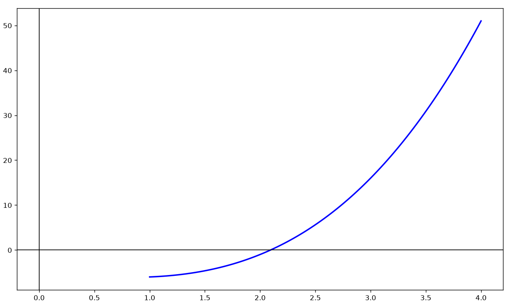
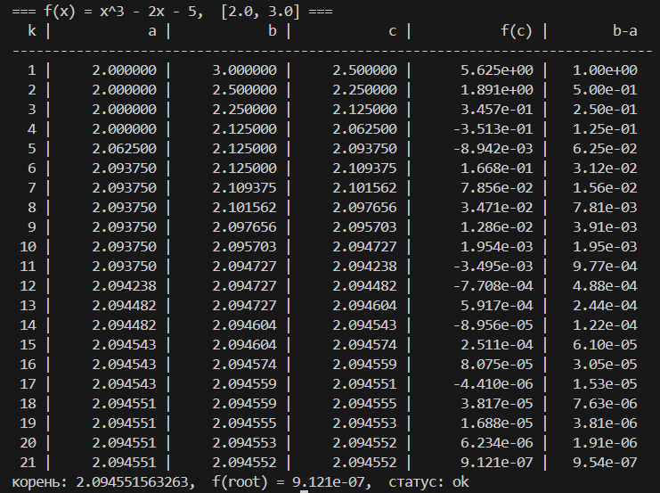
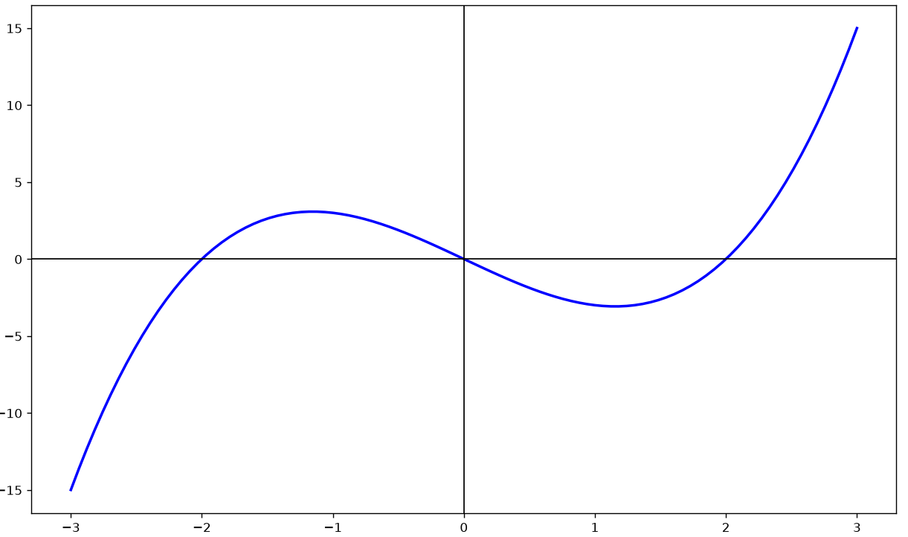
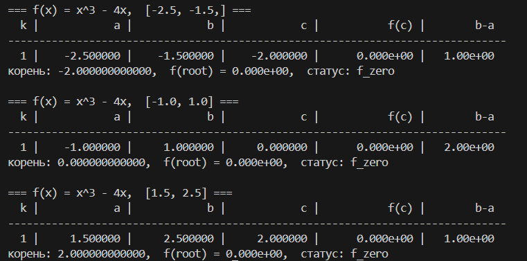
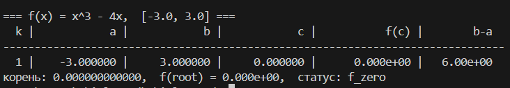
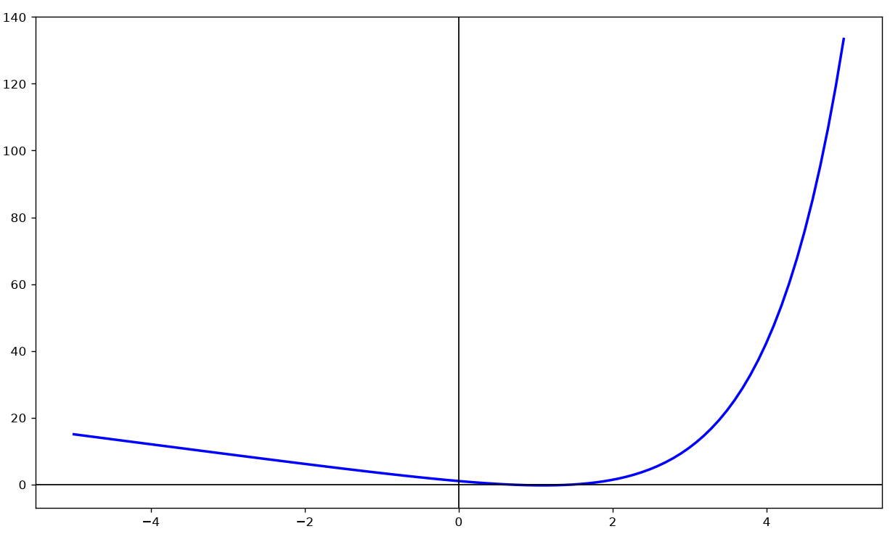
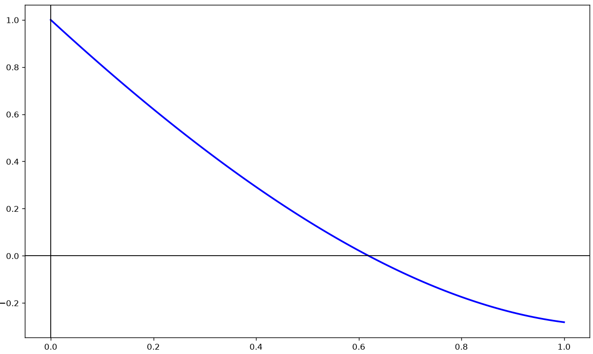
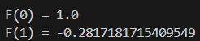
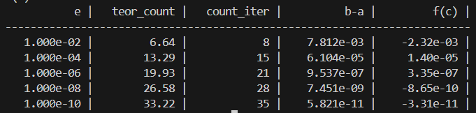

## Задача 1. Базовая бисекция с журналом

Дана функция f(x) = $x^{3}$ − 2x − 5.
1. Проверьте смену знака на отрезке [2, 3]: вычислите f(2) и f(3).
2. Реализуйте (или используйте готовую из лекции) функцию  bisection(f, a, b, eps, max_iter), которая возвращает корень и журнал итераций.
3. Найдите корень с точностью ε = $10^{-6}$. Выведите журнал в виде таблицы:  k | a | b | c | f(c) | b-a.
4. Проверьте результат: подставьте найденный корень в f(x) — должно получиться |f(x)| < $10^{-6}$.

Ответьте (1–2 предложения):
На какой итерации длина интервала впервые стала меньше $10^{-6}$? Совпадает ли это число с теоретической оценкой log₂(Δ₀ / ε)?
Ожидаемый корень: ≈ 2.094551.

**Вывод:**

Теоритическая оценка точности: log₂(3 - 2 / $10^{-6}$) ≈ 20. Длина интервала впервые стала меньше $10^{-6}$ на шаге 21, что почти совпало с теоритической оценкой. Ожидаемый корень совпал с вычесленным.

## Задача 2. Все корни на отрезке

Условие. Дана функция f(x) = x3 − 4x.
1. Постройте график f(x) на отрезке [−3, 3] (можно через 
matplotlib , можно просто
таблицей значений с шагом 0.5).
2. Локализуйте все корни: найдите три интервала, на каждом из которых f меняет знак.
Подсказка: корни — целые числа, проверьте значения −3, −2, −1, 0, 1, 2, 3.
3. Примените бисекцию к каждому интервалу с ε = 10−8.
4. Сравните результаты с аналитическим решением: x3 − 4x = x(x−2)(x+2) = 0 → корни −2,
0, 2.
5. Выведите таблицу: 
интервал | корень (числ.) | корень (аналит.) | |Δ| |
итераций.

Ответьте (1–2 предложения): Одинаковое ли число итераций для всех трёх корней? Почему?
Что произойдёт, если применить бисекцию к интервалу [−3, 3] целиком (без локализации)? Запустите и посмотрите, какой корень найдётся.

**Вывод:**

В моем случае число итерачий для всех трех корней вшло одинаковым, это связано с тем, какие границы интервалов были выбраны. Если применить бисекцию к интервалу [−3, 3], то будет найден тоолько корень 0, так как интервал [−3, 3] симетричен в обе стороны относительно начала координат, поэтому метод биссекции на первой итерации попадаеет в 0.

## Задача 3. Влияние точности на число итераций

Условие. Возьмите функцию f(x) = ex − 3x (у неё два корня).
1. Локализуйте один корень на отрезке [0, 1]. Проверьте: f(0) = 1 > 0, f(1) ≈ −0.28 < 0 —
смена знака есть.
2. Запустите бисекцию для ε = 10−2, 10−4, 10−6, 10−8, 10−10.
3. Постройте таблицу: 
ε | число итераций | длина финального интервала |f(корень)|.
4. Постройте график: по оси X — ε (в лог-шкале), по оси Y — число итераций. Убедитесь,
что зависимость линейная в полулогарифмических координатах.
5. Проверьте теоретическую формулу: n ≥ log₂(Δ₀ / ε), где Δ₀ = 1. Сравните с фактическим
числом итераций.

Ответьте (2–3 предложения): Каждое увеличение точности на 2 порядка (например, 10−4 → 10−6) — на сколько
итераций увеличивает работу? Совпадает ли это с теорией? Почему метод бисекции называют «гарантированно сходящимся, но медленным»?

**Вывод:**

Граффик на большем интервале:

Приближенный график:

При F(0) и F(1) наблюдается смена знака.

Биссекция длля разных порядков, с учетом теоритичесого количества итераций:

Каждое увеличение точности на 2 порядка требует на 7 итераций больше. Это практически совпадает с требованием теоритического расчета, но так как log не может расчитать идеально точное количество, то погрешность между изменениями точности не строго 7. Метод биссекции называют медленным, потому что деление каждого интервала в 2 раза не такой быстрый, как другие методы, но именно фиксированная скорость позволяет ему называтся градиентным.
