## Задача 1. Найти корень полинома тремя методами

Условие. Дана функция f(x) = x³ − 2x − 5.
1. Локализуйте корень: постройте график на [−1, 3] или проверьте смену знака f(2) и
f(3).
2. Найдите корень тремя методами с точностью ε = $10^{-10}$:
бисекция на найденном интервале;
Ньютон (f′(x) = 3x² − 2), старт — левая граница интервала;
секущие, две точки — левая и правая границы интервала.
3. Выведите журнал для Ньютона и для секущих.
4. Постройте таблицу.

Вывод: во сколько раз Ньютон быстрее бисекции? Совпадают ли корни до $10^{-10}$?

**Вывод:**

График:

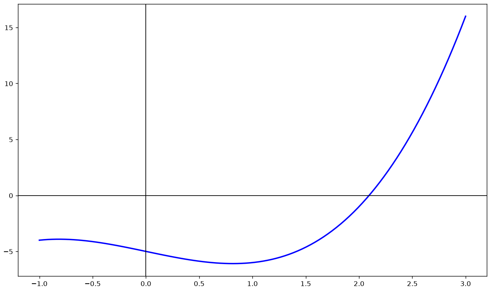

Проверка смены знака:

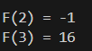

Метод Ньютона:

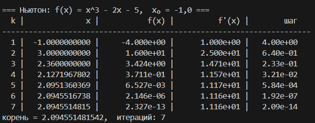

Метод Секущей:

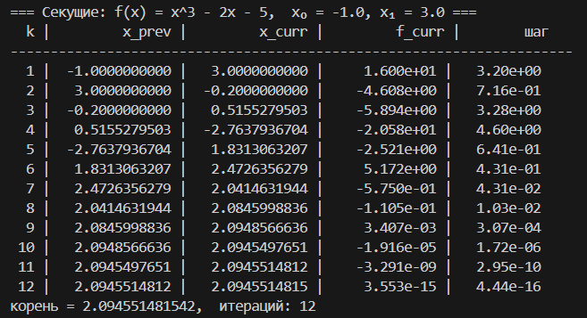

Метод Бисекции:

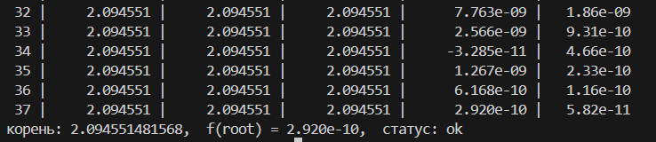

| Метод | Корень | Итераций |
|---|---|---|
| Бисекция | 2.094551481568 | 37 | 
| Секущие | 2.094551481542 | 12 | 
| Ньютон | 2.094551481542 | 7 | 

Корни совпадают до $10^{-10}$. Метод Ньютона быстрее бисекции на 30 итераций.

## Задача 2. Сравнить на функции с плохим стартом

Условие. Дана функция f(x) = x³ − 2x + 2. У неё один действительный корень (около
−1.769).
1. Постройте график на [−3, 3]. Убедитесь, что корень один.
2. Запустите Ньютона с x₀ = 0. Выведите журнал. Что происходит с f′(xk) и с шагом?
3. Запустите Ньютона с x₀ = −2. Сколько итераций?
4. Запустите секущие с x₀ = −2, x₁ = −1. Сколько итераций?
5. Запустите бисекцию на [−2, −1]. Сколько итераций?
6. Постройте таблицу:

Вывод: почему Ньютон с x₀ = 0 не сходится? Связано ли это с f′(xk)?

**Вывод:**

График:

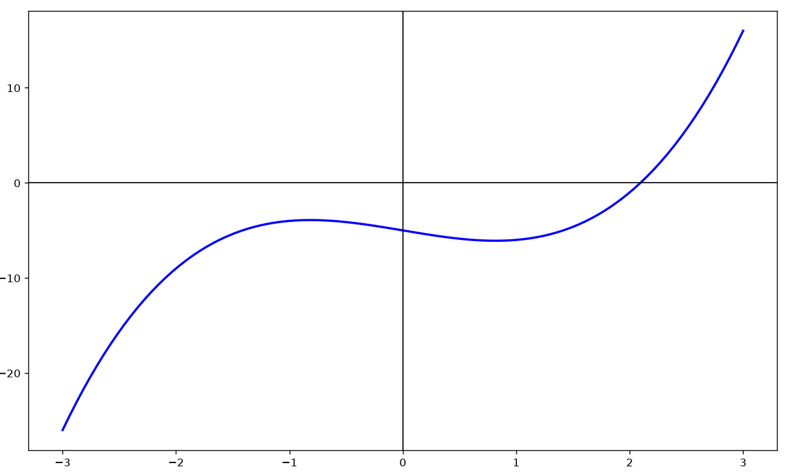

Метод Ньютона при старотвой точке 0:

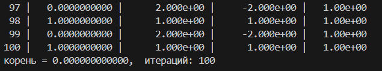

Метод Ньютона при старотвой точке 2:

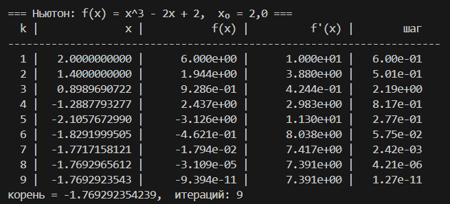

Метод Секущей:

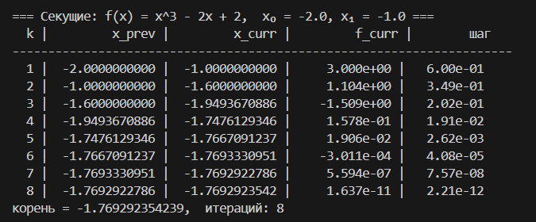

Метод Бисекции:

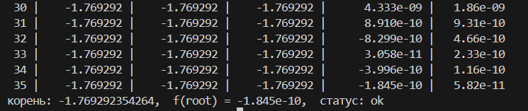

| Метод | Старт | Корень | Итераций |
|---|---|---|---|
| Ньютон | 0 | 0 | 100+ |
| Ньютон | 2 | -1.769292354239 | 9 | 
| Секущие | -2; -1 | -1.769292354239 | 8 |
| Бисекция | [-2; -1] | -1.769292354264 | 35 | 

Метод Ньютона при старотвой точке 0 не сходится, так как в методе Ньютона есть отношения функции к ее производной, которая в точке 0 равна 0 (отношение выдает 0 в функции), этот результат вычитается из самой точки, поэтому следущая точка сама равна 0, как следствие - метод не продвигается.

## Задача 3. Уравнение с параметром

Условие. Дано уравнение f(x) = cos x − kx = 0, где k > 0.
1. Для k = 0.5 локализуйте корень на [0, 2] и найдите его тремя методами
(бисекция, Ньютон, секущие) с ε = 10−10. f′(x) = −sin x − k.
2. Для k = 1, 2, 5 повторите только методом Ньютона. Постройте таблицу:
k = 1; 2; 5
3. Для k = 0.5 прогоните метод Ньютона с ε = 10−4, 10−8, 10−12. Постройте таблицу.

Вывод: как параметр k и точность ε влияют на число итераций? Совпадает ли рост
числа итераций с теоретической оценкой (квадратичная сходимость — примерно +1
итерация на каждые два знака точности)?

**Вывод:**

График:

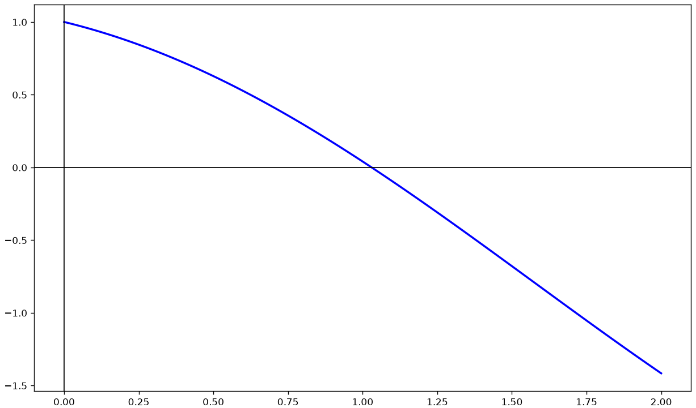

Метод Ньютона:

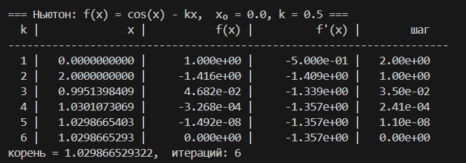

Метод Секущей:

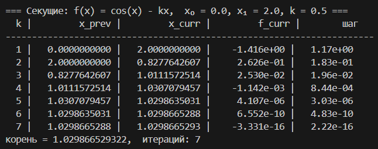

Метод Бисекции:

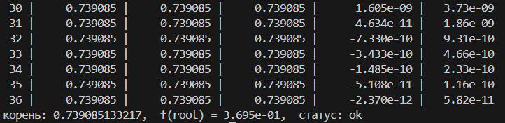

Метод Ньютона при разных k:

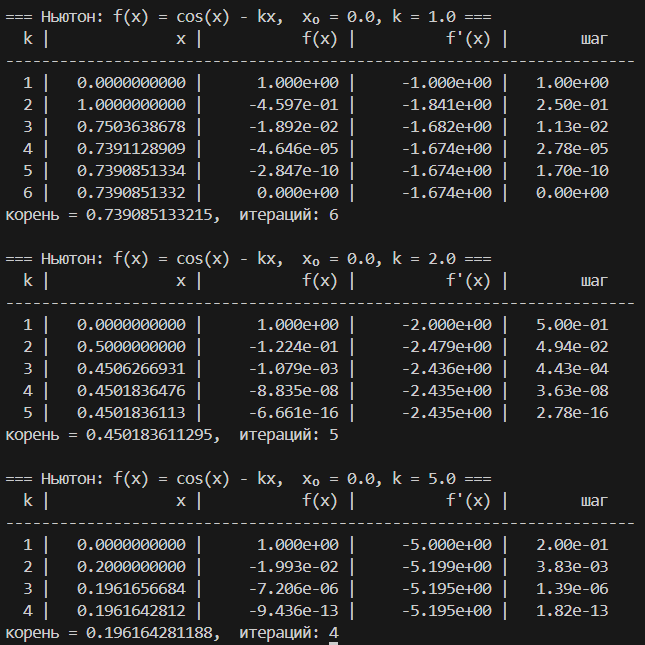

Метод Ньютона при разных eps:

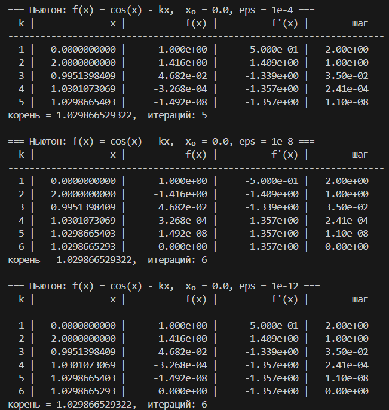

| k | Корень | Итераций Ньютона |
|---|---|---|
| 0,5 | 1.029866529322 | 6 | 
| 1 | 0.739085133215 | 6 | 
| 2 | 0.450183611295 | 5 | 
| 5 | 0.196164281188 | 4 | 

Чем больше k, темь меньше нужно итераций, так как делает сам результат функции больше.

| eps | Итераций | Фактическая ошибка |
|---|---|---|
| 1e−4 | 5 | < 1e-12 | 
| 1e−8 | 6 | < 1e-12 | 
| 1e−12 | 6 | < 1e-12 | 

Чемь меньше eps, тем больше итераций нужно, на практице +1 итерация дала точность на 4 знака. При этом корень при 1e−12 не отличается от точности 1e−4, что говорит о том, что ошибка меньше, чем 12 знак.