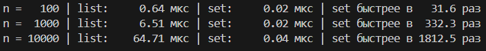
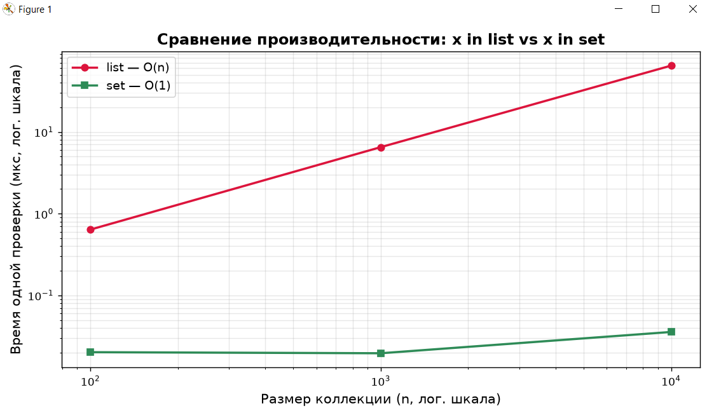

## Задача 1: Сравнить два способа проверки вхождения в коллекцию

**Условие.** Даны два способа проверить, есть ли число в коллекции: `x in list` и `x in set`. Напишите бенчмарк, который для `n = 100, 1000, 10000` замеряет время 1000 проверок в `list` и в `set`. Постройте график с лог-шкалой по Y.

**Требования:**
- Используйте `timeit` (не ручной замер).
- Сделайте `repeat=5`, берите минимум.
- Лог-шкала по оси Y.
- Выведите, во сколько раз `set` быстрее на каждом `n`.

**Текстовые подсказки:**

1. **Подготовка данных.** Для каждого `n` создайте `data_list = list(range(n))` и `data_set = set(range(n))`. Ищите число, которого в коллекции **нет** (например, `-1`) — это худший случай для `list`: он пройдёт весь список до конца, и разница с `set` будет максимально наглядной.

2. **Как передать переменные в `timeit`.** Функция `timeit.repeat(stmt, globals=..., number=..., repeat=...)` принимает словарь `globals`, в котором лежат переменные, используемые в строке `stmt`. Например, `globals={"target": target, "data_list": data_list}`. Без этого `timeit` не увидит ваши данные.

3. **Нормировка на одну проверку.** `timeit` возвращает **суммарное** время за `number` выполнений. Чтобы получить время одной проверки, разделите результат на `number`. Затем умножьте на `1_000_000`, чтобы перевести секунды в микросекунды — так числа читаемее.

4. **Выбор лучшего замера.** `timeit.repeat` возвращает список из `repeat` значений. Берите `min(...)` — это защищает от случайных выбросов CPU.

5. **Лог-шкала.** После `ax.plot(...)` вызовите `ax.set_yscale("log")`. Для сетки, которая видна и на мелких делениях, используйте `ax.grid(True, which="both", alpha=0.2)`.

6. **Ожидаемый результат.** На лог-шкале линия `set` должна быть почти горизонтальной (O(1)), а линия `list` — расти с наклоном (O(n)). Если `list` не растёт — вы, скорее всего, ищете существующий элемент, и `list` находит его в начале.

7. **Вывод в консоль.** В цикле по `n` печатайте время обоих вариантов и отношение `t_list / t_set` — это и есть «во сколько раз быстрее».

