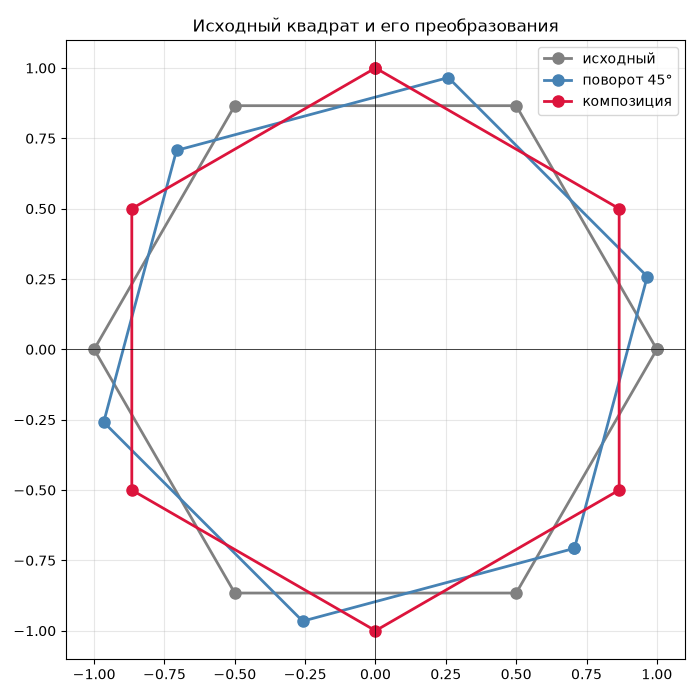
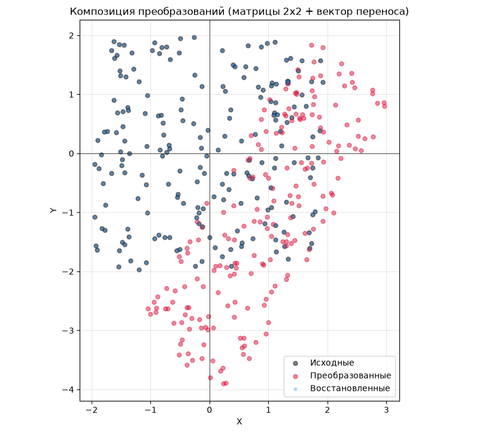
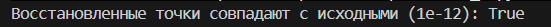

## Задача 1. Поворот и отражение правильного шестиугольника

Условие. Постройте правильный шестиугольник с центром в начале координат и
радиусом 1. Вершины шестиугольника задаются формулами:
xk = cos(2πk/6),   yk = sin(2πk/6),   k = 0, 1, …, 5
Замкните контур (добавьте первую вершину в конец). Затем:
1. Поверните шестиугольник на 45° против часовой стрелки матрицей поворота 2×2.
2. Отразите исходный шестиугольник относительно прямой y = x. Матрица
отражения относительно этой прямой:( 0   1 ;   1   0 )
3. Постройте исходный, повёрнутый и отражённый шестиугольники на одном
графике (три цвета, легенда, 
set_aspect('equal') ).

Что сдать: скрипт, график, и ответ на вопрос: почему отражённый шестиугольник
выглядит «повёрнутым», хотя это отражение, а не поворот? (Подсказка: сравните
матрицы поворота на 90° и отражения относительно y = x — они совпадают с
точностью до знака.)

Отраженный шестиугольник выглядит «повёрнутым» из-за геометрии самой фигуры, линия, вокруг которой происходит отражение, пересекает ребра шестиугольника не по центру, поэтому отраженный шестиугольник не может идеально лечь на исходный.

## Задача 2. Композиция преобразований и обратное преобразование

Условие. Дан набор из 200 случайных точек, равномерно распределённых в квадрате
[−2, 2] × [−2, 2] (используйте 
np.random.default_rng(42) ). Выполните над точками
композицию:
1. Масштабирование: sx = 1.5, sy = 0.5.
2. Поворот на 60° против часовой стрелки.
3. Перенос на вектор (1, −1) — через однородные координаты 3×3.

Постройте исходное и преобразованное облака на одном графике. Затем восстановите
исходные точки, применив обратные преобразования в обратном порядке:
1. Обратный перенос: (−1, 1).
2. Обратный поворот: на −60°.
3. Обратный масштаб: sx = 1/1.5, sy = 1/0.5.

Проверьте через np.allclose , что восстановленные точки совпадают с исходными с точностью 1e−12.

Что сдать: скрипт, график «исходные / преобразованные / восстановленные», и ответ
на вопрос: почему обратные преобразования нужно применять в обратном порядке?
Что произойдёт, если применить их в прямом порядке? (Подсказка: (AB)−1 = B−1 A−1.)

Обратные преобразования нужно применять в обратном порядке так как этот порядок действий определяет путь, проделанный фигурой, если поменять порядок обратных действий, то обратное движение не приведет в исходную точку.