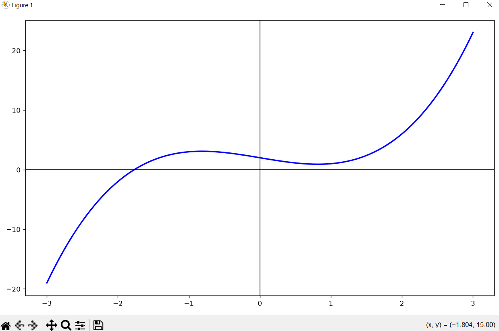
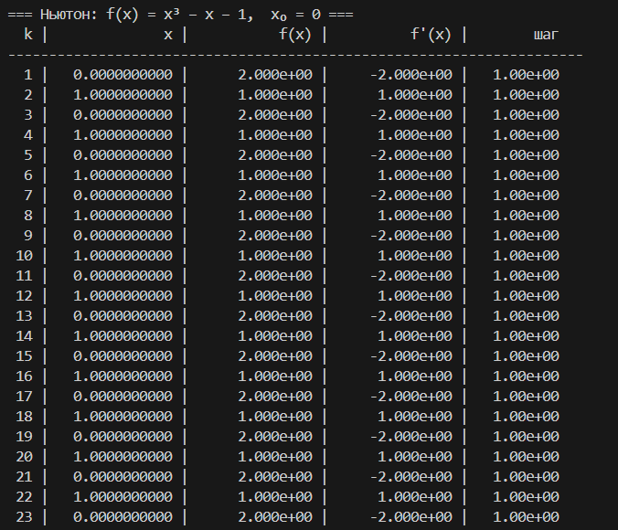
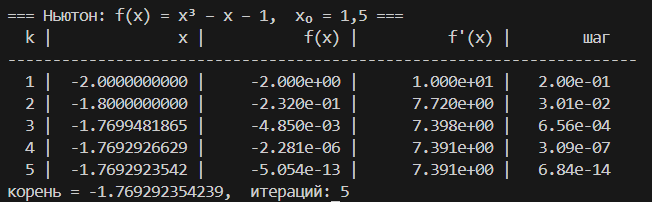
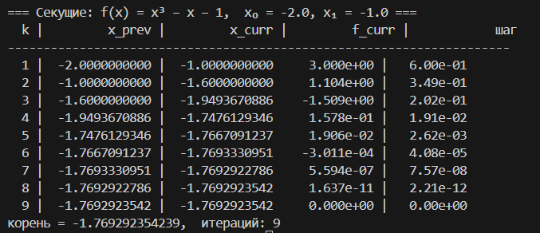
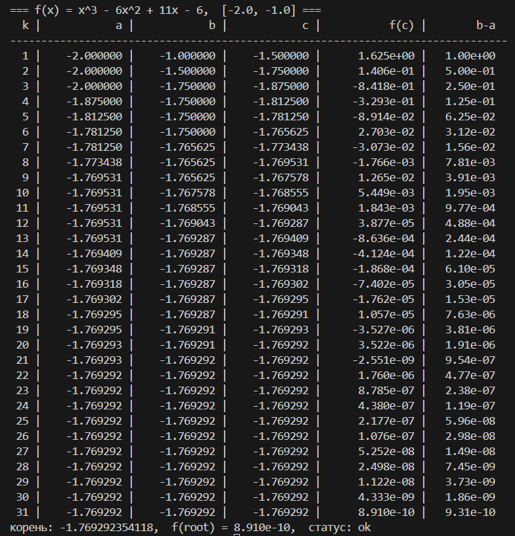

## Задача 1. Сравнить методы на функции с плохим стартом

Условие. Дана функция f(x) = x³ − 2x + 2. У неё один действительный корень (около
−1.769).
1. Постройте график на [−3, 3]. Убедитесь, что корень один.
2. Запустите метод Ньютона с x0 = 0. Что происходит? Почему метод не сходится?
(Подсказка: постройте журнал и посмотрите на f′(xk).)
3. Запустите метод Ньютона с x0 = −2. Сколько итераций?
4. Запустите метод секущих с x0 = −2, x1 = −1. Сколько итераций?
5. Запустите бисекцию на [−2, −1]. Сколько итераций?
6. Постройте таблицу: метод → старт → корень → итераций. Объясните, почему
метод Ньютона с x0 = 0 «застревает».

**Что сдать:** скрипт, график, журналы, таблица, вывод о том, как выбор начального
приближения влияет на сходимость.

При х = 0 метод Ньютона не сработает, так как f(0) = 2 а f'(0) = -2. При расчете шага х2 = 0 - (2/-2) = 1. При расчете следущего шага f(1) = 1 а f'(1) = 1 -> х3 = 1 - (1/1) = 0, это создает цикл и не позволяет методу продвинутся.

При х = 1,5 точность достигнута за 5 итераций.

При х1 = -2 и х2 = -1,0 метод секущих достиг точности за 9 итераций.

При х1 = -2 и х2 = -1,0 метод биссекции достиг точности за 31 итерацию.

**Вывод:**
Выбор начальной сходимости может влиять на общее количество итераций, но более важно, как выбранные значения сочитаются с выбранным методом. Выбрать начального значения зависит от функции. 
